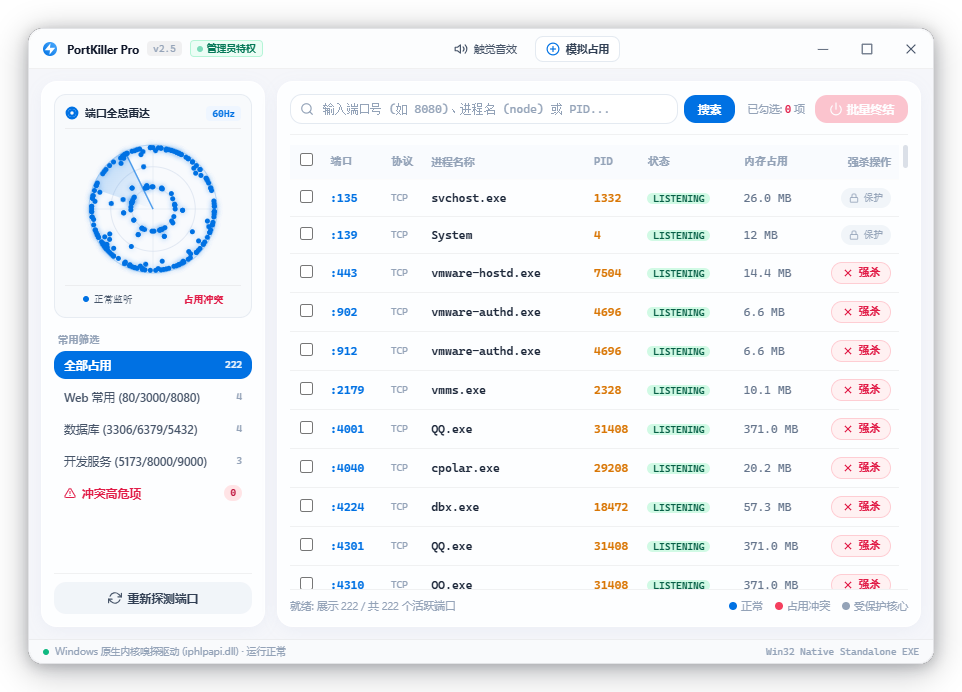
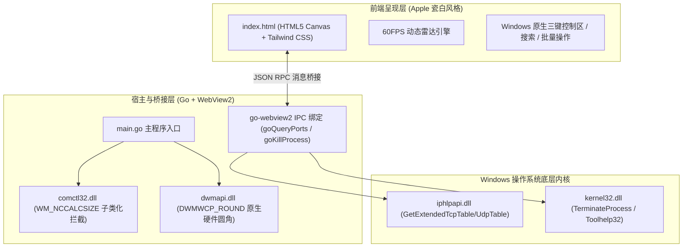

<div align="center">

# ⚡ PortKiller Pro (端口占用终结者)

**纯正苹果瓷白美学 · 毫秒级 Win32 内核端口嗅探 · 级联进程树强杀 · 2.27 MB 绿色单文件 EXE**

[](https://github.com/995william/william-ProtKiller/releases)
[-blue?style=flat-square&logo=windows)](https://github.com/995william/william-ProtKiller)
[](https://golang.org)
[](https://github.com/995william/william-ProtKiller/releases)
[](LICENSE)

<br/>

<p align="center">
  
</p>

<p align="center">
  <a href="#-快速开始与下载">快速下载</a> •
  <a href="#-核心特性">核心特性</a> •
  <a href="#-界面与视觉美学">界面美学</a> •
  <a href="#-本地编译构建">本地构建</a> •
  <a href="#-架构与底层技术实现">技术实现</a> •
  <a href="#-常见问题-faq">常见问题</a>
</p>

</div>

---

## 📖 项目简介

作为全栈开发者，在本地启动 Web 开发服务（Vite、Webpack、Next.js）、后端服务（Go、Java Spring、Python FastAPI）或数据库（MySQL 3306、Redis 6379）时，经常会遇到令人头疼的 **`EADDRINUSE: address already in use`** 端口被占用冲突。

传统的解决方式繁琐低效：
1. 打开控制台执行 `netstat -ano | findstr :8080` 查询 PID；
2. 再执行 `tasklist | findstr <PID>` 确认是哪个程序；
3. 最后再执行 `taskkill /F /PID <PID>` 强制关闭。

**PortKiller Pro** 是一款专为 Windows 平台打造的高性能、极简、高颜值的端口管理与强杀工具：
* **单文件即开即用**：全量仅 **2.27 MB**，绿色免安装，内嵌全部前端资产与系统权限清单；
* **苹果瓷白美学**：融合 Windows 11 DWM 硬件圆角与 Apple 极简矢量质感，告别粗糙界面；
* **直通 Win32 内核**：纳秒级直读 Windows 网络表，支持一键级联结束整棵进程树。

---

## ✨ 核心特性

* ⚡ **纳秒级 Win32 内核端口嗅探**：
  弃用繁琐低效的控制台管道解析，底层直接调用 Windows 操作系统 API `iphlpapi.dll`（`GetExtendedTcpTable` / `GetExtendedUdpTable`），毫秒级瞬时获取整机 TCP/UDP 监听与占用详情。
* 💀 **精准级联进程树强杀（Tree Kill）**：
  调用 Windows 底层 `kernel32.dll` 中的 `CreateToolhelp32Snapshot` 递归遍历目标进程的所有派生子进程，再通过 `TerminateProcess` 实现级联连带强杀，彻底消灭孤儿/僵尸后台进程。
* 🛡️ **核心系统进程硬核白名单防护**：
  内置操作系统关键进程过滤机制（包含 PID 0/4、`System`、`svchost.exe`、`csrss.exe`、`services.exe` 等），重要核心服务显示置灰保护徽章，严禁误杀导致系统崩溃。
* 🍎 **纯正苹果瓷白视觉美学（Apple Ceramic Light）**：
  * **Win11 DWM 硬件级圆角**：调用 `dwmapi.dll` 激活系统原生硬件抗锯齿大圆角与外周柔和漫反射物理投影；
  * **SF Symbols 极简矢量图标**：告别 Windows 彩色 Emoji，全界面采用高精度 SVG 线性矢量图标；
  * **SF Pro 苹果排版字系**：排版选用 Apple 官方字体规范与 `SF Mono` 等宽数字，数据变动无视觉抖动；
  * **60 FPS 全息雷达扫描**：原生 HTML5 Canvas 驱动的 360° 动态全息雷达扫描视效。
* 🪟 **冷启动 0 闪烁与 0 白边黑科技**：
  * **双缓冲预设初始化**：直接在 Win32 消息循环第一帧锁定 920×650 居中创建，彻底消除“先小窗口再变大”的视觉突变；
  * **Win32 子类化拦截 `WM_NCCALCSIZE`**：彻底消灭 Windows 传统无边框窗口自带的 8 像素外部白色非客户区边框与死区。
* 🔊 **Web Audio 触觉音效引擎**：
  无需加载任何外部音频 MP3 文件，利用 Web Audio API 振荡器以纯正数学正弦波实时合成轻触微反馈。

---

## 📦 快速开始与下载

### 方式一：直接下载成品（推荐）

1. 前往本仓库的 [**Releases 页面**](https://github.com/995william/william-ProtKiller/releases)；
2. 下载最新的 **`PortKiller.exe`**（单文件仅约 2.27 MB）；
3. **双击直接运行**（程序已嵌入管理员提权清单，若弹出 UAC 提示请点击“是”，以获取强杀服务端口的特权）。

> [!TIP]
> 目标运行电脑无需预先安装 Go、Node.js 或 Python 等任何语言环境。在 Windows 10（自带 Edge WebView2）与 Windows 11 上均可完美开箱即用。

### 方式二：浏览器免安装原型预览

如果您仅希望体验交互动效与原型设计，可直接使用现代浏览器打开项目目录下的 [prototype.html](prototype.html)，即可体验完整的高保真界面与模拟交互。

---

## 🛠️ 本地编译构建

如果您希望对源代码进行二次开发或自行编译二进制文件：

### 前置条件
* Windows 10 或 Windows 11 (x64)
* [Go 1.20 或更高版本](https://golang.google.cn/)

### 一键极速构建

直接双击运行根目录下的 **`build.bat`**，或在命令行中执行：

```bash
# 1. 整理与拉取依赖
go mod tidy

# 2. 编译生成独立单文件 EXE (剥离调试符号、隐藏控制台黑框)
go build -ldflags "-H windowsgui -s -w" -o PortKiller.exe
```

#### 编译参数深度解析：
* `-H windowsgui`：声明为 Windows GUI 子系统程序，运行启动时**完全不弹出黑色的 cmd 控制台窗口**；
* `-s`：剥离可执行文件中的符号表信息（Symbol Table）；
* `-w`：剥离 DWARF 调试信息（极大压缩二进制体积至 2.27 MB）；
* `rsrc.syso`：由 `app.manifest` 生成的 Windows 资源文件，会在编译期自动嵌入应用程序图标、UAC 管理员特权声明与高分屏 DPI-Aware 属性。

---

## 🏛️ 架构与底层技术实现



### 1. 内核网络表直读 (`port_scanner.go`)
通过 Windows `iphlpapi.dll` 提供的 `GetExtendedTcpTable` 和 `GetExtendedUdpTable`，使用无符号结构体直接解析 TCP 状态表（`MIB_TCP_STATE_LISTEN`、`MIB_TCP_STATE_ESTAB` 等），单次整机嗅探仅耗时 **2~5 毫秒**。

### 2. 级联进程树连带清理 (`port_scanner.go`)
通过 `CreateToolhelp32Snapshot(TH32CS_SNAPPROCESS)` 拍摄系统进程快照，构建父子 PID 映射图谱，执行递归遍历，在强杀主进程前优先终止全部衍生工作进程，确保不留死锁句柄。

### 3. 0 闪烁与 0 白边窗体渲染 (`main.go`)
* 在 `WebViewOptions.WindowOptions` 中显式指定 `Width: 920, Height: 650, Center: true`；
* 窗口创建初期调用 `ShowWindow(SW_HIDE)` 剥离 `WS_CAPTION`；
* 挂载 `SetWindowSubclass` 拦截 `WM_NCCALCSIZE` 消息直接返回 `0`，使得 Client Area 物理级铺满窗口矩形，彻底吞并无边框自带的 8 像素外沿白边；
* 调用 `DwmSetWindowAttribute` 注入 Windows 11 原生硬件大圆角（`DWMWCP_ROUND`）。

---

## 📂 仓库目录结构

```
william-ProtKiller/
├── .github/
│   └── workflows/
│       └── release.yml          # GitHub Actions 自动化发布流水线 (打 Tag 自动构建并发布 Release)
├── docs/                        # 项目设计与探索技术文档
│   ├── DESIGN_SPEC.md           # 交互设计全套规范与配色指标
│   ├── TECH_SOLUTION.md         # 架构选型深度报告 (Go+WebView2 方案解析)
│   └── prototypes/              # 历史交互探索原型存档
│       ├── prototype_apple_and_multistyle.html
│       ├── prototype_desktop_6styles.html
│       └── prototype_v3_multilayout.html
├── app.manifest                 # Windows 应用程序清单 (声明管理员 UAC + 高分屏感知)
├── build.bat                    # Windows 本地一键编译脚本
├── go.mod                       # Go 模块配置文件
├── go.sum                       # Go 依赖校验和
├── index.html                   # 内嵌前端界面 (苹果瓷白高保真 UI，编译期打包进 EXE)
├── main.go                      # 桌面端主程序入口 (Win32 窗口配置、DWM 硬件圆角、IPC 桥接)
├── port_scanner.go              # Windows 底层端口内核嗅探与级联强杀实现
├── prototype.html               # 快速浏览器预览版 (免安装环境，在浏览器即可交互)
├── rsrc.syso                    # 编译级 Windows 资源对象文件 (内嵌清单与图标)
├── .gitignore                   # Git 忽略配置 (自动排除二进制与临时文件)
├── LICENSE                      # 开源协议 (MIT License)
└── README.md                    # 项目官方中文说明文档
```

---

## ❓ 常见问题 (FAQ)

### Q1: 为什么程序启动时提示“需要管理员权限”？
强杀处于监听状态的系统服务端口（例如占用 80 端口的 `IIS`、占用 443 端口的后台服务，或属于其他用户会话的进程）需要 Windows 系统内核级别的 `PROCESS_TERMINATE` 特权。本程序在 `app.manifest` 中声明了 `requireAdministrator`，确保一键强杀绝对成功。

### Q2: 为什么我的电脑无法终止某些特定端口？
如果端口属于 PID 为 `0`、`4` 或系统关键进程（如 `System`、`csrss.exe`），PortKiller Pro 会自动触发**系统级白名单保护**，操作列会显示置灰的“受保护”徽章以防系统蓝屏崩溃。

### Q3: 为什么软件体积只有 2.27 MB？其他 Electron 软件往往有 100MB+？
传统的桌面端技术（如 Electron、NW.js）会将整个 Chromium 浏览器引擎和 Node.js 运行时一起打包，导致体积动辄 100~200 MB。
PortKiller Pro 采用 **Go 原生系统编程 + 嵌入式 Windows WebView2 方案**，复用了现代 Windows 10/11 系统自带的 Edge 渲染引擎，同时 Go 编译时剥离了调试符号，因此最终产物仅 **2.27 MB**，不仅体积轻巧，而且内存占用低、启动速度极快。

---

## 📄 开源协议

本项目采用 [MIT 许可证](LICENSE) 开源，欢迎自由下载、使用或参与贡献。
